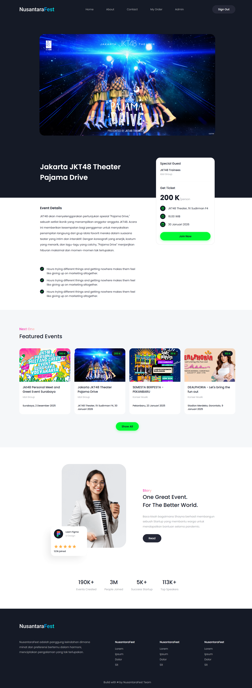
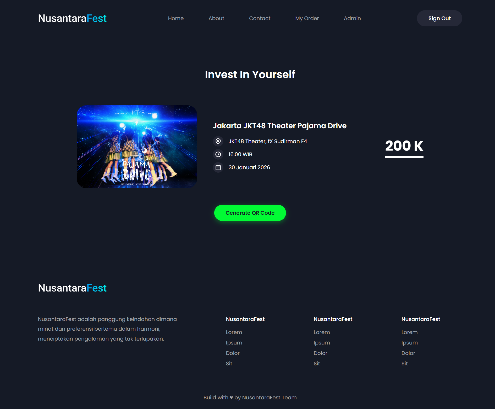

# NusantaraFest - Event Website

The NusantaraFest event website is built using React and Firebase. This platform allows users to explore various events, view details, and book tickets online.

## About The Project

NusantaraFest is a website platform dedicated to showcasing and managing various events. Users can easily browse available events, view complete details, and book tickets. This project also comes with a functional admin dashboard to manage event data, users, and orders.

### Key Features

- Event browsing and details.
- Online ticket booking.
- User authentication (Login & Register).
- Admin Dashboard for management (CRUD for Users, Events, Orders).
- Responsive design for various devices.

### Technologies Used

- **Frontend:** React.js, Vite
- **Backend & Database:** Firebase (Authentication, Firestore, Hosting)
- **Styling:** CSS

## Installation Guide

To run this project locally, follow these steps:

### Prerequisites

Make sure you have Node.js and npm installed on your system.

### Steps

1.  **Clone this repository:**

    ```sh
    git clone https://github.com/username/project-repository.git
    cd final-website-event-vocasia
    ```

2.  **Install all required dependencies:**

    ```sh
    npm install
    ```

3.  **Configure Environment Variables:**
    Create a `.env` file in the project's root directory and copy the contents from `.env.development`. Replace the values with your own Firebase credentials.

    ```env
    VITE_API_KEY=xxxxxxxxxxxxxxxxxxxxxxx
    VITE_AUTH_DOMAIN=xxxxxxxxxxxxxxxxxxxxxxx
    VITE_PROJECT_ID=xxxxxxxxxxxxxxxxxxxxxxx
    VITE_STORAGE_BUCKET=xxxxxxxxxxxxxxxxxxxxxxx
    VITE_MESSAGING_SENDER_ID=xxxxxxxxxxxxxxxxxxxxxxx
    VITE_APP_ID=xxxxxxxxxxxxxxxxxxxxxxx
    ```

4.  **Run the application (development mode):**

    ```sh
    npm run dev
    ```

    The application will run at `http://localhost:5173`.

5.  **Build for production:**
    ```sh
    npm run build
    ```
    The production files will be created in the `dist/` directory.

## Website Preview

### Home


### Event Detail



### Checkout


